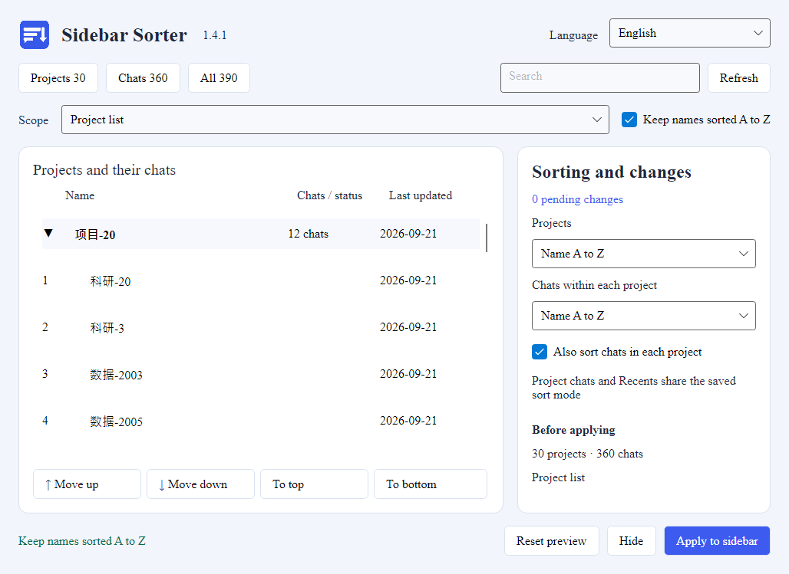

# Codex Sidebar Sorter

A standalone desktop companion for organizing Codex projects and chats. Preview two levels of ordering, choose from seven sorting modes, and keep supported sidebar items in ascending name order with an independent background worker.



[简体中文](README.zh-CN.md) · [User guide](docs/03-product-guide.md) · [Validation results](docs/02-validation.md) · [Agensi submission](agensi/README.md)

## Features

- Separate sorting choices for projects and chats within each project.
- Seven modes covering names, natural numbers, update times, and manual order.
- Automatic ascending-name sorting after additions and renaming.
- Search, scope selection, project and chat views, change previews, drag ordering, and movement buttons.
- An independent background worker and native tray menu that continue after the window closes.
- Twelve interface languages, including Arabic right-to-left layout.
- A self-contained Windows installer with the runtime, application icon, language resources, and source.

Sidebar synchronization depends on the installed Codex client's local interface and access authorization. The compatibility table below records the current evidence.

## Languages

Simplified Chinese, Traditional Chinese, English, Japanese, Korean, French, German, Spanish, Portuguese, Italian, Russian, and Arabic.

The system-language option selects a supported interface language. A manual selection is saved in the companion's own preferences.

## Sorting modes

| Mode | Behavior |
| --- | --- |
| Name A to Z | Ascending names, with Chinese comparison based on `zh-CN` |
| Name Z to A | Descending names |
| Natural numeric order | Numeric parts follow 2, 10, 20 |
| Reverse natural order | Descending natural numbers |
| Recently updated first | Newest timestamps first, missing values last |
| Oldest update first | Oldest timestamps first, missing values last |
| Manual order | Drag rows or use Move up, Move down, To top, and To bottom |

Choosing a custom rule, moving rows, or resetting the preview pauses automatic name sorting. Selecting **Keep names sorted A to Z** resumes it. **Apply to sidebar** submits a manual choice.

## Getting started

1. Obtain the Windows 1.4.1 installer from the maintainer's verified release channel.
2. Choose an installation directory and install the bundled application.
3. Open a compatible, signed-in Codex Desktop client.
4. Open Codex Sidebar Sorter and select **Refresh**.
5. Select the scope and review the project and chat preview.
6. Use automatic ascending-name sorting or choose and apply a manual rule.

Close the companion window to keep its worker and tray running. Use **Open Sidebar Sorter** in the tray to reopen the window and **Exit** to stop the companion.

The current repository is private, and a public installer download is pending. Public download access is part of the remaining marketplace delivery work.

## Compatibility and verification

| Component | Verified scope |
| --- | --- |
| Windows x64, macOS ARM64, Linux x64 shared core | 21 checks per platform |
| Multilingual desktop and automatic worker | Twelve languages, 30 fictional projects, 360 fictional chats |
| Windows 1.4.1 installer | Custom Unicode paths, bundled runtime, running upgrades, retained settings, full exit and reopening, uninstall |
| Official Windows client 26.1111.2228.0 | Window close, full exit, reopening, worker independence, update check, and unchanged client files |
| Official macOS client | Accessibility permission granted and 218 actual login-screen controls read. Signed-in sidebar reordering is pending |
| Official Linux client | Tool catalog read. Signed-in sidebar reordering is pending |
| Actual client version replacement | Pending |
| macOS and Linux consumer installers | Pending real-client acceptance |

The Windows official-client lifecycle run used a signed-out cloud profile. Authenticated real-client sorting has its own remaining acceptance work. The Windows installer and desktop automation results use fictional protocol fixtures.

Native project ordering covers unpinned projects in the default Projects section. Chat ordering covers supported Codex project chats and chats in pinned or custom sections. ChatGPT project-chat ordering, independent alphabetical Recents ordering, and pinned project placement require additional client support.

The latest Windows/Linux follow-up runs were prevented from starting by the GitHub account billing check. The last fully accepted Windows installer corresponds to `036f029`, version `1.4.1`.

[Shared core results](https://github.com/syj3426962511-glitch/codex-sidebar-sorter/actions/runs/43866519115) · [Desktop results](https://github.com/syj3426962511-glitch/codex-sidebar-sorter/actions/runs/43867351898) · [Windows installer results](https://github.com/syj3426962511-glitch/codex-sidebar-sorter/actions/runs/43867345247) · [Windows client lifecycle](https://github.com/syj3426962511-glitch/codex-sidebar-sorter/actions/runs/43854854495)

## Architecture

The desktop UI, sorting worker, and native tray have separate lifecycle responsibilities. The worker coalesces local file events and waits while idle. Application operations use the companion's IPC channel for coordination.

The companion stores its own language and sorting preferences. History queries use read-only SQLite connections. Supported ordering requests go through Codex's existing local tools. Client interfaces, authorization, and history schemas are versioned integration dependencies.

## Build

Source builds use .NET 10. Native trays use Windows C++, macOS Cocoa, and Linux Ayatana AppIndicator.

```sh
dotnet build desktop/SidebarSorter.Desktop.csproj -c Release
dotnet run --project tests/CoreTests.csproj -c Release -- src artifacts/core-results.json
```

- `desktop/` contains the shared UI, worker host, and native trays.
- `src/` contains ordering, history reading, settings, localization, and legacy upgrade fixtures.
- `tests/` contains core, desktop, installer, and official-client acceptance drivers.
- `packaging/windows.iss` defines the current Windows installer.
- `.github/workflows/` contains platform-specific build and acceptance workflows.

[Development notes](docs/01-development.md)

## Marketplace companion

The Agensi submission provides an English agent skill for installing, configuring, and operating the Windows companion. The requested price is **USD 9.50 for a one-time purchase**. Its package, listing copy, compatibility requirements, and submission status are maintained in `agensi/`.

## License

MIT. See [LICENSE](LICENSE).
