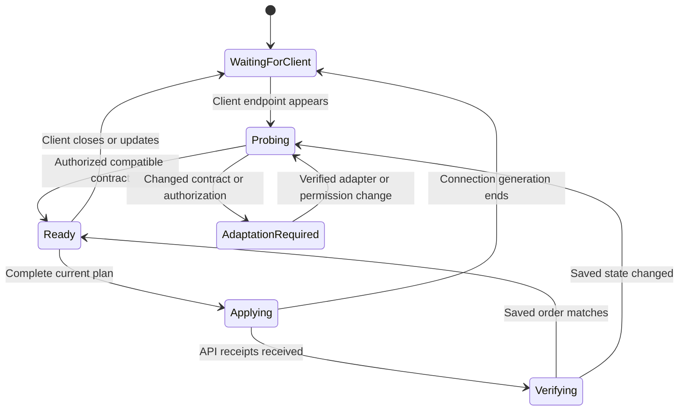

# Future-version compatibility design

## Outcome and support contract

The companion keeps project and chat ordering rules in its own data directory and synchronizes eligible items with the original Codex sidebar through an authorized, tested adapter. Codex retains its normal installer, launcher, update path, and shutdown lifecycle.

Two acceptance results are recorded independently for every client build. Client lifecycle acceptance covers installation, startup, window close, full exit, replacement, and reopening. Sidebar acceptance covers the actual saved and visible order after authentication. Both results are required to list a build as fully supported.

Future releases enter the tested matrix after they become available. Interface-compatible releases can reuse an adapter automatically. Changes to operation semantics, authorization, transport, or response structure require a tested adapter revision. These cases are part of the maintenance process.

## Process and storage boundaries

| Component | Responsibility | Storage and lifetime |
| --- | --- | --- |
| Desktop window | Preview, languages, sorting choices, status | Companion installation and preferences |
| Independent worker | Coalesce changes, calculate differences, coordinate writes | Continues when the window or Codex closes |
| Adapter host | Discover the client, negotiate capabilities, execute and verify supported ordering | Companion-owned process and files |
| Adapter package | Translate a known client contract into the companion's operations | Companion-owned adapter directory |
| Codex Desktop | Own conversations, persist sidebar order, update itself | Original installation and data lifecycle |

All companion launch paths use a durable, self-contained runtime. Client discovery resolves the currently registered application or active endpoint on each connection. Versioned installation paths are excluded from saved companion settings.

The adapter uses client APIs to persist supported ordering. History fallback uses read-only SQLite access. Sorting preferences and adapter updates are written to the companion's directory. A previously authorized MCP registration remains an optional integration choice and requires a successful platform acceptance result before activation.

## Minimal adapter contract

Use the existing `SorterService` and sorting representations as the consumer. Introduce an adapter boundary at `NativeBridge`, keeping the UI and sorting algorithms independent of transport details.

```csharp
interface ISidebarAdapter : IAsyncDisposable
{
    Task<SidebarCapabilities> ProbeAsync(CancellationToken cancellationToken);
    Task<SidebarSnapshot> ReadSnapshotAsync(CancellationToken cancellationToken);
    Task<ApplyReceipt> ApplyOrderAsync(SidebarOrderPlan plan,
        CancellationToken cancellationToken);
}
```

These types describe the planned boundary. They have yet to be added to the production source.

Capabilities identify each supported scope and operation individually. Required fields include backend, host, account context, project membership, read completeness, supported order modes, write authorization, and read-back verification. A complete feature matrix distinguishes unpinned projects, Codex project chats, ChatGPT project chats, pinned chats, pinned projects, custom sections, and Recents.

## Connection and capability negotiation

1. Discover the running client and its current endpoint. Record the desktop build, platform, account context, and connection generation when exposed.
2. Read the advertised operations and available parameter schemas. Preserve the full descriptors. When a transport supplies names alone, select a cloud-validated legacy contract and verify its read responses.
3. Select an adapter by its supported transport and consumed contract. Version numbers describe test evidence. They are a secondary selection input.
4. Validate the required parameter types, enum values, required fields, scope semantics, and consumed response fields. Additional optional fields remain compatible when the consumed contract still matches.
5. Perform read-only list and preference probes. Check pagination, stable identifiers, source, host, project membership, and the completeness required by each operation.
6. Expose the resulting capability set to the UI and automatic worker. Prepare each batch using the capabilities available on its current connection.

Schema fingerprints identify diagnostic evidence and cached probe results. Matching uses the consumed contract, allowing compatible additions. A renamed operation or changed semantic requires a reviewed mapping. The adapter never infers write semantics from a similar name alone.

App Server has version-specific generated schemas and an initialization handshake. Its project and conversation capabilities are evaluated separately from the desktop sidebar contract. The current desktop sidebar implementation uses local desktop tools, and its availability remains platform- and authorization-dependent. [Official App Server documentation](https://learn.chatgpt.com/docs/app-server)

## Adapter routes

| Route | Activation requirement | Scope |
| --- | --- | --- |
| Authorized client ordering API | Advertised operations, accepted caller, known semantics, cloud read-back acceptance | Preferred sidebar synchronization |
| Platform Accessibility | Granted OS permission, recognized controls and actions, successful background write acceptance | Specific tested scopes |
| Read-only history | Recognized history fields and complete membership mapping | Inventory and preview |

Windows UI Automation, macOS Accessibility, and Linux AT-SPI adapters use stable identifiers, roles, accessible names, and supported actions. Locale-specific labels belong to the adapter profile. Each write requires a unique target, the expected source and project, and an accessible saved-order check.

The background acceptance driver records the frontmost application and mouse position around operations. An Accessibility route becomes eligible after it passes those checks and the real ordering check. A scope whose only available interaction requires foreground input stays in an adaptation-required state under the owner's background-operation requirement.

macOS currently has a successful read probe with granted Accessibility permission. Signed-in background reordering remains an open acceptance item. The earlier native authorization rejection remains recorded, and that route stays inactive.

## Independent adapter updates

The distributable design uses a small data-only adapter package for operation mappings, consumed schemas, response mappings, capability rules, and Accessibility locators. New transports or executable behavior ship as a companion application update. Neither form of update modifies the Codex installation.

The adapter release manifest contains its schema version, monotonically increasing release sequence, companion compatibility range, platform, adapter ID, consumed-contract identifiers, package digest, and download URL. The publisher signs the exact UTF-8 manifest bytes with ECDSA P-256 and SHA-256. A detached signature uses the 64-byte IEEE P1363 representation, encoded as Base64 for distribution. An embedded publisher public key verifies the manifest signature before its package digest and download URL are consumed. The release signing key belongs to the publisher's protected release environment.

The updater checks the publisher's HTTPS release channel once daily, when a newly observed contract requires adaptation, or on an explicit user check. It downloads into a companion-owned temporary directory, verifies the signature and size limits, validates mappings, and runs read-only probes. Activation occurs between sorting batches through an atomic active-package pointer. Network failure retains the current working package.

Keep the active and previous verified package. A failed activation returns to the previous package when that package matches the current client contract. An incompatible previous package leaves synchronization waiting for adaptation. Offline operation uses the bundled or cached compatible package.

This update system, publisher key provisioning, and data-only package interpreter are implementation work. Current releases use adapters compiled into the companion.

## Client exit, upgrade, and recovery



The worker retains the requested sorting rules while waiting. Endpoint and file events trigger a coalesced reconnect, with bounded exponential backoff after transient failures. The worker never launches Codex as part of waiting or reconnection.

A disconnect ends the current connection generation. A replacement client receives a fresh discovery, capability negotiation, and snapshot. The next plan is calculated from the current saved state. Completion is reported after read-back confirms the planned order.

Batch planning verifies required operations before the first mutation. Write requests preserve source, host, project membership, pinned slots, and section membership. A partial batch records the confirmed operations and refreshes saved state before calculating a retry. Ordering calls provide convergent retries where the client supports them. A server-wide transaction is available only when the client supplies it.

Rollback covers the companion adapter and its own preferences. Saved sidebar restoration uses a newly validated snapshot and the current authorized ordering API, with membership checked again.

## Historical client and data coverage

The existing read-only history adapter probes optional columns and selects the consumed fields. It covers title-only records, optional agent paths, second and millisecond timestamps, saved names, project identifiers, legacy project assignments, and attached-child filtering.

Historical desktop releases are grouped by actual transport, authorization, and data contracts. Each group receives representative authenticated client execution. Different contracts receive separate profiles. Versions predating an exposed ordering operation require a successful Accessibility implementation for the requested sidebar scope.

The six history-schema fixtures establish data-reading behavior. Each desktop build's sidebar ordering and lifecycle evidence is entered separately in the support matrix.

## Cloud validation and release policy

| Test group | Required evidence |
| --- | --- |
| Compatible contract additions | Extra optional parameters, unrelated response fields, stable consumed semantics |
| Breaking contract changes | Missing operation, changed required parameter, enum removal, changed identifier or response semantics |
| Ordering | Seven modes, duplicate names, natural numbers, all advertised scopes, saved and visible read-back |
| Concurrent activity | Additions, renaming, deletion, project moves, manual order changes, interrupted batches |
| Lifecycle | Ordinary launch, window close, full client exit, companion survival, client reopen, full companion exit |
| Client replacement | Install an available previous official build, apply ordering, replace it with the target official build, cold launch, re-probe, sort and read back |
| Companion update | Running upgrade, custom path, bundled runtime, retained preferences, reopening, uninstall |
| Background behavior | Foreground and pointer preserved, event coalescing, idle CPU and memory sample |
| Adapter update | Signature rejection, interrupted download, offline cache, activation, compatible rollback |

All functional, installation, and client-operation tests run on disposable cloud hosts under the owner's instruction. Authentication stays in the temporary test account session. Receipts record exact client build, companion revision, adapter revision, platform, scope, result, and evidence URL. Public records contain test identities and counts without authentication material or personal conversation content.

A release watcher compares official client distribution metadata once daily and opens a cloud validation run for a newly observed build. It schedules validation through the repository's CI. Builds with an available authenticated test session proceed through real ordering acceptance. Other builds retain a pending result until that session is supplied.

## Implementation sequence and current status

| Step | Deliverable | Current status |
| --- | --- | --- |
| 1 | Independent worker, tray, runtime, preferences, endpoint discovery | Implemented |
| 2 | Historical read-only field negotiation | Implemented in 1.4.2, 26 core checks passed on three cloud platforms |
| 3 | Full tool descriptors, consumed-contract matching, per-scope preflight | Operation-name preflight implemented for grouped submissions, full descriptor and schema matching planned |
| 4 | Shared adapter boundary and verified platform Accessibility routes | Planned, macOS read probe available |
| 5 | Signed data-only adapter updates with atomic activation | Planned |
| 6 | Automated official-build detection and real-client regression matrix | Planned, existing cloud workflows provide the starting point |
| 7 | Public consumer installer and Agensi buyer delivery | Source and Windows preview installer public, Windows workflow skill live at USD 9.50, production acceptance and actual paid-buyer delivery open |

The source repository and Windows preview installer are public. The current successful core run is `43888466005`, and Windows 1.4.2 installed-upgrade acceptance is `43888952292`. Authenticated real-sidebar ordering and actual client version replacement remain open. [Core acceptance](https://github.com/syj3426962511-glitch/codex-sidebar-sorter/actions/runs/43888466005) · [Windows installed-upgrade acceptance](https://github.com/syj3426962511-glitch/codex-sidebar-sorter/actions/runs/43888952292)
